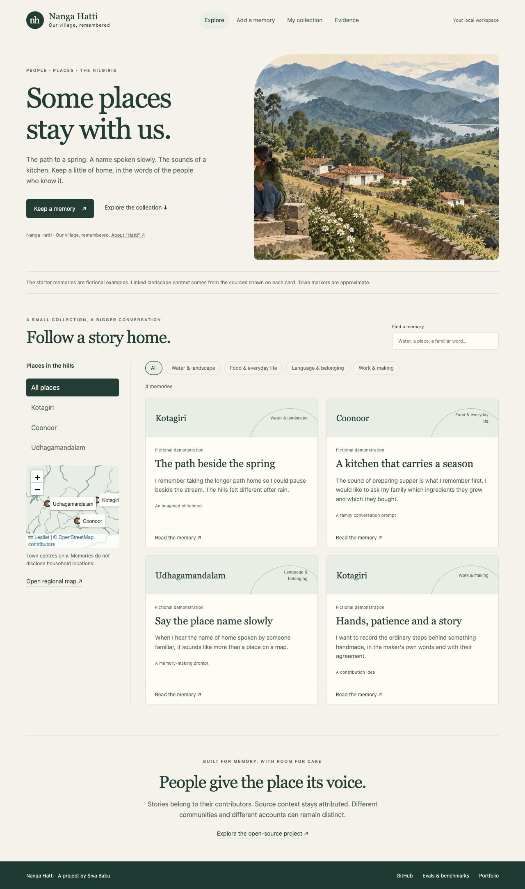
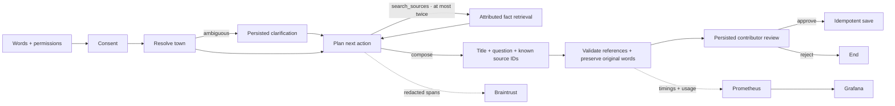
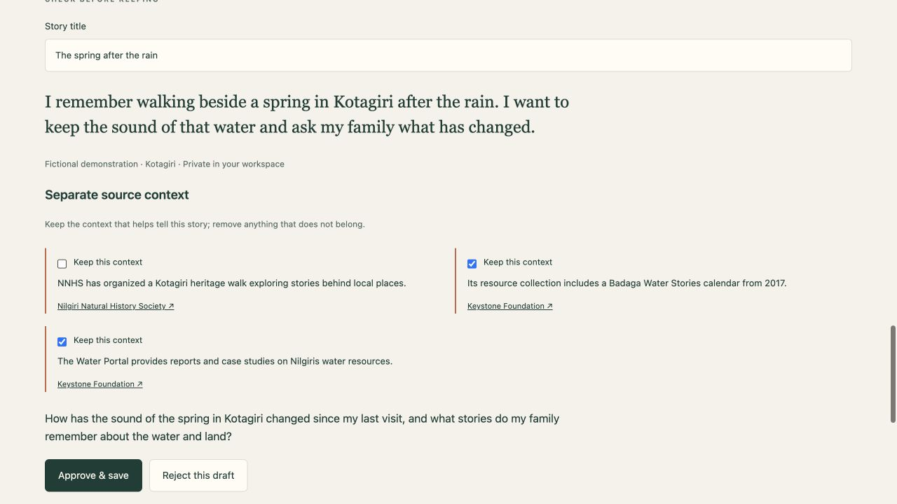
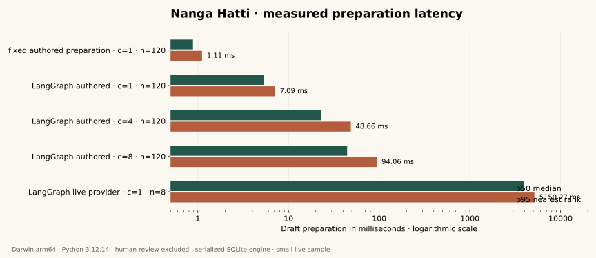
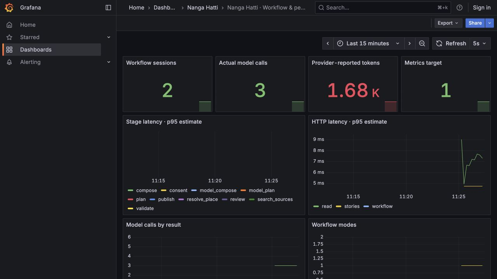

# Nanga Hatti

**Our village, remembered.** A place for Nilgiris memories, familiar voices and the landscapes around them.

[Explore the public demo](https://sivalinb.github.io/nanga-hatti/) · [Engineering evidence](https://sivalinb.github.io/nanga-hatti/lab/) · [Siva Babu's portfolio](https://sivalinb.github.io/)


A path beside a spring. A kitchen that carries a season. The way someone says the name of home. Nanga Hatti keeps a contributor's words intact, prepares separate source-linked context, and asks them to review the result before saving it.

Built by **Siva Babu**, following [Hatti Quest](https://github.com/sivalinb/hatti-quest). Nanga Hatti explores community memory and place through a working contribution app, a bounded LangGraph agent, Braintrust traces and evals, and Prometheus/Grafana monitoring.

The public demo is a **read-only explorer** with fictional starter memories and recorded engineering evidence. The complete contribution, clarification, review and private-save workflow runs in the local Python application. No real community story collection or community partnership is claimed for this release.

## What you can do

- Explore stories by town, theme or text on an attributed OpenStreetMap geometry snapshot.
- Keep a memory verbatim, with its attribution, approximate period and chosen visibility.
- Attach audio or a photograph in your browser; enter a recording's words manually when desired.
- Clarify an ambiguous place, edit the proposed title, remove source context, approve or reject the draft.
- Resume a waiting review after a server restart, inspect its trace, and export story text or download media separately.



## A real workflow with a contributor at the centre



**LangGraph** supplies state transitions, a bounded planning/tool loop, persistent SQLite checkpoints, and two `interrupt()`/`Command` review boundaries. In live mode, the model chooses source-search queries and prepares a title, reflection question and known fact IDs. Default authored mode uses the same graph and review gates without a model bill.

**Braintrust** records explicitly redacted spans and uploads evaluation experiments from real executions. Memory text, attribution, audio and photographs are excluded from this telemetry. Model generation requires both server configuration and explicit opt-in for that contribution; opted-in memory text goes to the configured provider.

**Evals** verify consent enforcement, town clarification, review before saving, visibility, verbatim memory preservation, bounded searches and reference membership. **Grafana** shows stage latency, HTTP latency, model calls, reported tokens, workflow outcomes, contributor decisions and last-loaded authored eval scores.



[Architecture and data boundaries](docs/ARCHITECTURE.md) · [Evaluation methodology](docs/EVALS.md)

## Run the full local app

Python **3.12 or newer**:

```sh
git clone https://github.com/sivalinb/nanga-hatti.git
cd nanga-hatti
python3 -m venv .venv
source .venv/bin/activate
pip install -r requirements.txt
python run.py
```

Open **http://127.0.0.1:8787/**. Choose **Add a memory → Try a fictional example → Prepare for review**. Approve the draft to save it, or change the place to an unknown name to exercise clarification. No key is required for authored mode.

Optional live generation and redacted Braintrust spans:

```sh
export NANGA_LIVE_AI=1
export NANGA_LLM_KEY_FILE=/absolute/private/provider-key-file
export NANGA_BRAINTRUST_KEY_FILE=/absolute/private/braintrust-key-file
python run.py
```

Check **Allow these words to be sent to the configured AI provider** on the fictional example. The default tested provider is Nebius with `Qwen/Qwen3-30B-A3B-Instruct-2507`; override the base URL/model through the documented settings and rerun the live suite when changing providers. Environment variables can alternatively supply `NEBIUS_API_KEY` and `BRAINTRUST_API_KEY`. The native server does not automatically load `.env`.

## Measured evidence

Recorded on **13 October 2026**. These are curated engineering fixtures; they do not measure Badaga pronunciation, cultural authority, community adoption or learning effectiveness.

| Check | Recorded result | Scope |
| --- | --- | --- |
| Python tests | **29 passed** | Graph, restart/resume, API guards, review, source validation and storage |
| Authored workflow suite | **50/50** expected outcomes; all eight workflow guards 100% | Includes explicit simulated failures |
| Retrieval | **Recall@3 1.000; MRR@3 0.975** | 20 queries authored against the small bundled corpus |
| Live provider suite | **8/8 fully live**; all workflow guards 100% | 22 actual model calls; 10,566 reported tokens |

[Authored results](evals/reports/latest.json) · [Live results](evals/reports/live.json) · [Recorded fictional traces](evals/reports/live-traces.json) · [Braintrust experiment](https://www.braintrust.dev/app/siva-project/p/Nanga%20Hatti/experiments/workflow-20261013-164245-live) *(account access required)*

The traces exposed a prompt/schema mismatch during development. Prompt v2 separates planning and composition schemas; the retained [earlier mixed-mode run](evals/reports/schema-v1-mixed.json) and subsequent live suite show the repair and its validation.

## Performance benchmarking



| Preparation mode | Runs | Concurrency | p50 | p95 | Throughput | Failures |
| --- | ---: | ---: | ---: | ---: | ---: | ---: |
| Fixed authored baseline | 120 | 1 | 0.88 ms | 1.11 ms | 1,108.46/s | 0 |
| LangGraph authored | 120 | 1 | 5.37 ms | 7.09 ms | 177.20/s | 0 |
| LangGraph authored | 120 | 4 | 22.93 ms | 48.66 ms | 179.14/s | 0 |
| LangGraph authored | 120 | 8 | 44.31 ms | 94.06 ms | 175.43/s | 0 |
| LangGraph live provider | 8 | 1 | 3,976.66 ms | 5,150.27 ms | 0.26/s | 0 |

Darwin arm64, Python 3.12.14, 10 logical CPUs. Timings cover **in-process preparation through the review boundary**, excluding human review. The fixed baseline uses the same authored node functions and ledger/event writes but has no graph checkpoints. Concurrent runs share a serialized SQLite engine. Three authored warmups per configuration and one live warmup are excluded.

The eight live benchmark runs were all fully live: **22 model calls, 10,553 reported tokens**. With eight samples, nearest-rank p95 is effectively the maximum observed sample. These are development-machine measurements, not production capacity estimates or HTTP/browser latency guarantees. Dollar cost is unknown without verified pricing settings.

[Benchmark JSON](benchmarks/reports/latest.json) · [Measurement scope](docs/BENCHMARKS.md)

```sh
pip install -r requirements-dev.txt
python -m pytest -q
python -m nanga.cli eval
python -m nanga.cli eval --live --cases 8 --upload-braintrust
python -m nanga.cli benchmark --iterations 120
python -m nanga.cli benchmark --live --iterations 120
# Optional figure regeneration:
pip install -r requirements-visuals.txt
python ops/plot_benchmark.py
```

GitHub Actions runs tests, authored evals and a separate 40-iteration benchmark on Python 3.12 and 3.13, retaining CI evidence as artifacts. It never bills a live model call.

## Grafana and Prometheus

Two provisioned dashboards, **16 panels**, and three Prometheus alert rules are included. The screenshot below is from the actual native local monitoring preview, showing the fictional browser run's calls/tokens and a healthy scrape target.



```sh
# In your shell or a private .env, set GRAFANA_ADMIN_PASSWORD first.
docker compose up --build -d
```

Open the app on **8787**, Prometheus on **9098**, and Grafana on **3018**, all bound to localhost. Dashboard UIDs: `nanga-workflow` and `nanga-quality`. Alerts have no external notification destination. Docker is not installed on the development host, so the Compose build has not been executed there. Native Prometheus 3.14.0 and Grafana 12.1.1 were verified; Promtool validated all three rules.

[Monitoring configuration](ops) · [Operations](docs/OPERATIONS.md) · [Completed validation and limits](docs/VALIDATION.md)

## Content and care

**Nanga Hatti** is Siva Babu's chosen name. “Our village, remembered” is an English tagline, not a certified literal translation. [Community sources for the words and landscape](docs/SOURCES.md) are documented separately.

The 20 attributed fact records and 12 source entries offer context, not verification of a personal account. The starter stories and evaluation memories are fictional. Public markers indicate approximate town centres; the app does not request household or sacred-site coordinates.

Text and checkpoints stay in the local workspace; recordings and photographs stay in that browser's IndexedDB. Download media separately before clearing browser data. Private text remains in the local SQLite databases. A public shared contribution service would need contributor identities, ownership controls, quotas, retention practices and community stewardship before deployment.

The cover was generated with the built-in **Imagegen** tool; it is an imaginative illustration, not documentary photography. [Exact illustration prompt](docs/illustration-prompt.txt). App/Grafana images are actual screenshots. Original software and documentation are MIT; OpenStreetMap data retains ODbL and vendored Leaflet retains its license.

## Public explorer build

```sh
python -m nanga.cli preview
```

This creates `dist/` from fictional starter content and fictional evaluation evidence. It never exports the local collection. The Pages workflow deploys this read-only explorer. Browse its stories, sources, traces, evaluation results and benchmark chart; run the local app for contribution and review.

[Contributing](CONTRIBUTING.md) · [License](LICENSE)
