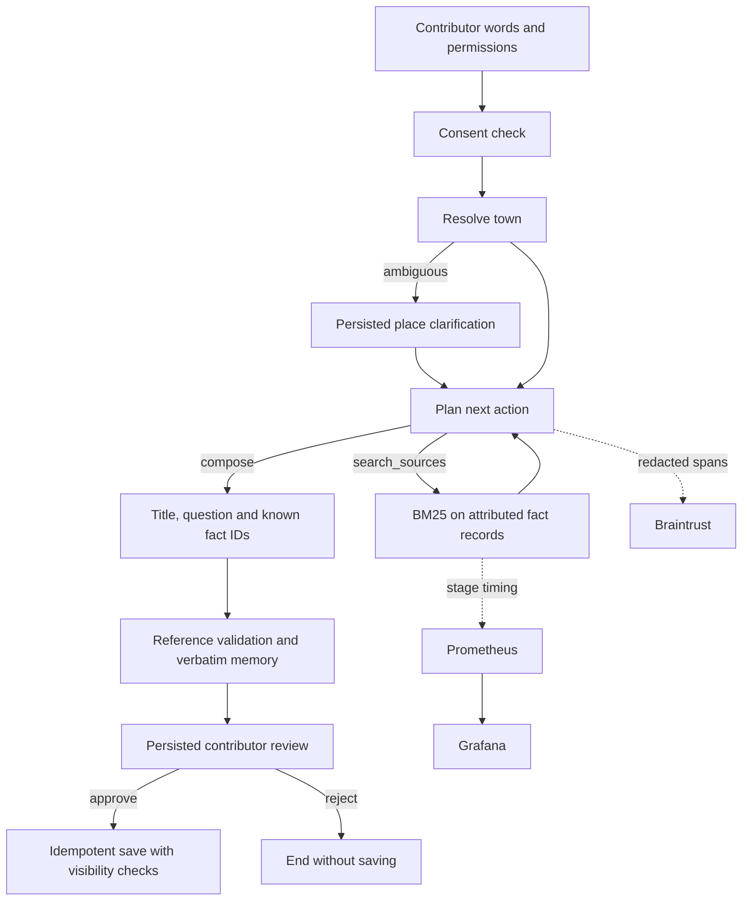

# A memory becomes a reviewed record

Nanga Hatti is a Python 3.12+ FastAPI application with a browser interface and a real LangGraph StateGraph. The default mode uses authored decisions; optional live mode uses the configured model to select source searches and compose a title, reflection question and known source IDs. Both modes use the same tool contracts, permission checks, validation and contributor review.

The workflow has consent, resolve_place, clarify_place, plan, search_sources, compose, validate, review and publish nodes. The plan/search loop permits at most two source searches; the graph also has a recursion limit. Place and review nodes use `interrupt()` and resume with `Command`. SqliteSaver stores checkpoints on disk, so a new process can resume a waiting task. Side effects occur after the review interrupt. A unique story ID and `INSERT OR IGNORE` prevent duplicate saves after repeated approval.

There are three distinct records: the contributor's original memory (an unverified personal account), separate attributed context, and engineering execution evidence. A model cannot rewrite the stored memory or provide arbitrary source IDs. Source IDs are checked against the evidence returned for that particular run. Structural validation does not prove that a chosen fact is relevant or culturally appropriate; the contributor checks the card before saving.

`collection.sqlite` stores runs, redacted events and stories. `checkpoints.sqlite` stores workflow state, including the private contribution. Both are ignored by Git. Audio and photos remain in browser IndexedDB; they are not uploaded or sent to the model. The contributor enters a transcript manually if words from a recording should be processed. Clearing browser data deletes those attachments. Text export does not contain media; download attachments separately from the story.

Provider calls require the server's live configuration and the contribution's AI opt-in. Requests send the text memory, theme and public retrieved records to the configured provider. Braintrust uses explicit spans, with only run IDs, stage outcomes, source/corpus versions, counts and usage. Prometheus labels are bounded categories. Neither telemetry system receives memory text, attribution, recordings or photographs through this integration.

The engine serializes runs with a lock around SQLite and checkpoint access. This keeps the local workspace predictable but limits concurrent throughput and can make a live provider request block another contribution. Move to a worker queue and a production checkpointer before a multi-user deployment.

The public explorer is a static export of fictional starter records, public source context and fictional evaluation evidence. The builder never reads the local collection database. It checks recorded trace memories against the fictional evaluation fixture set before publishing. Contribution tools operate in the local Python app; the public explorer explains that boundary.

Official references: [LangGraph interrupts](https://docs.langchain.com/oss/python/langgraph/interrupts), [persistence](https://docs.langchain.com/oss/python/langgraph/persistence), [Braintrust instrumentation](https://www.braintrust.dev/docs/instrument).
